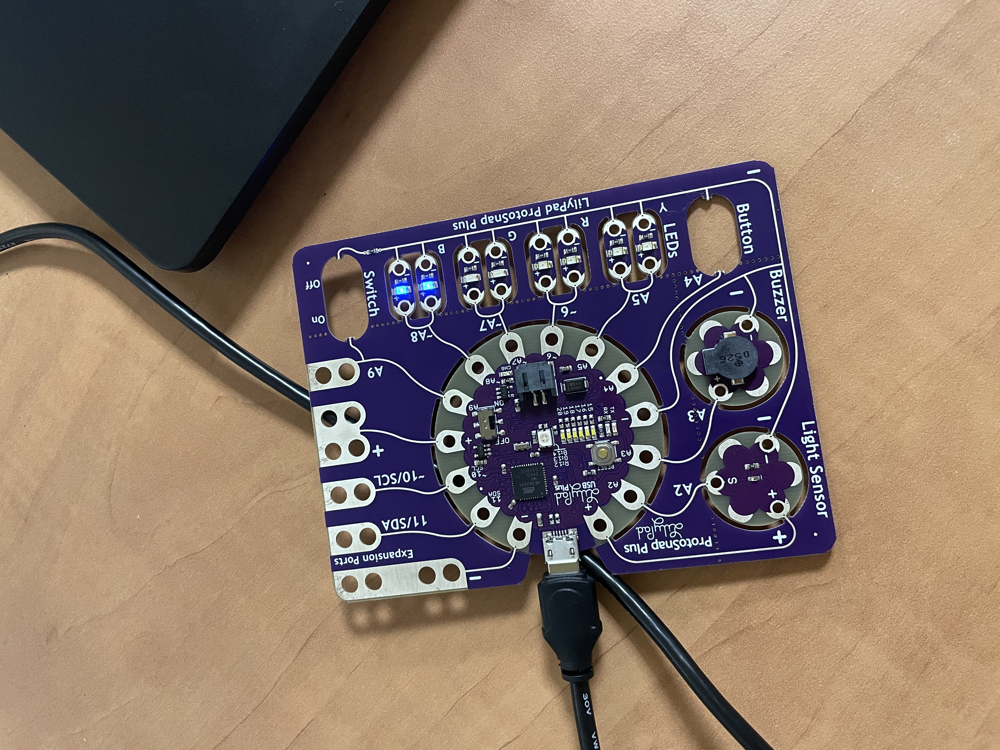

For this homework, I made an Arduino program that picks a random pin every second. If that pin is off it turns on at a random brightness. If it's already on it turns off, so the lights keep changing on their own.

To do this I used two arrays. One holds the pins that can change brightness and the other one remember if each pin is on or off.

Here is a photo:

**Tip for past me:** The pin number and the spot in the array are two different things. Pin 10 is not the 10th spot. So, pick a random spot in the array first and use that same spot to check if the LED is on or off and which pin it belongs to.
