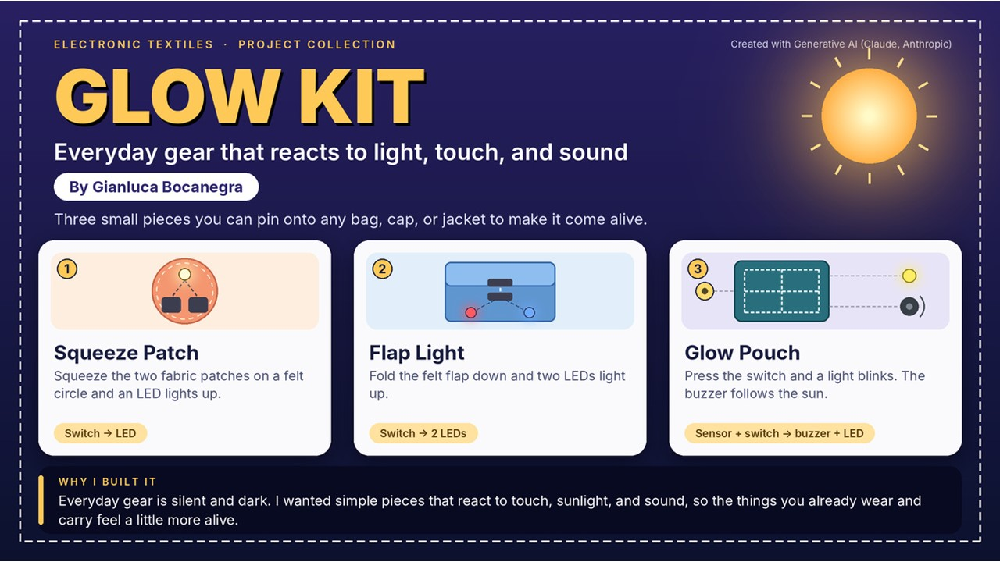
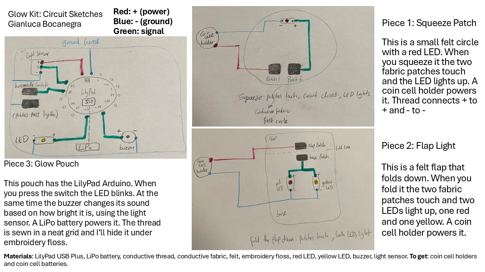

For my project collection, I'm making Glow Kit. It's three small pieces that light up or make sound when you touch them or when the light changes. You can pin them onto a bag, a cap, or a jacket.

Here is Slide 1 with the idea and why I want to make it:

Here is Slide 2 with my circuit sketches and materials list:

**My 1-minute pitch**

Hi, I'm Gianluca, and my project is called Glow Kit. Most of the stuff we carry around is dull and doesn't do anything, so I made three small pieces that react to you.

Piece 1 is the Squeeze Patch. When you squeeze it two fabric patches touch and an LED turns on.

Piece 2 is the Flap Light. When you fold the flap down two LEDs turn on.

Piece 3 is the Glow Pouch, and it uses a LilyPad Arduino. When you press the switch an LED blinks. At the same time, a buzzer changes its sound depending on how bright it is.

All three pieces use homemade fabric switches. On Piece 3, I'll sew the conductive thread in a neat grid and cover it with embroidery floss so it looks nice. I'm excited to build it. Thank you!

**What I still need:** coin cell holders and coin cell batteries for Pieces 1 and 2.

**Sources:** I made Slide 1 with AI (Claude). I drew the circuit sketches on Slide 2 by hand.
