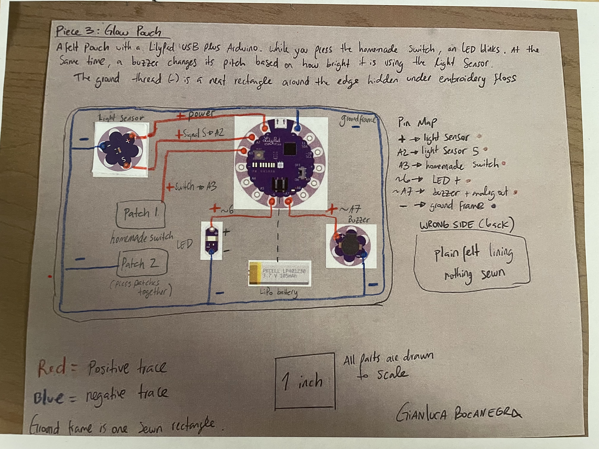

For my project collection I'm making 3 small felt pieces called Glow Kit. Each one reacts to something you do: squeeze it, fold it or shine light on it. You could pin them onto a bag, a cap, or a jacket. Here are my paper prototypes for each piece. 

## Piece 1: Squeeze Patch
A small felt circle with a red LED. If you squeeze it, two fabric patches touch and the LED turns on. A coin cell battery on the back powers it.

## Piece 2: Flap Light
A felt flap that folds down. When you close it, two fabric patches touch and two LEDs light up, one red and one yellow. It also has a coin cell battery on the back.

## Piece 3: Glow Pouch
A small pouch with an Arduino inside. When you press the switch an LED blinks. At the same time, a buzzer changes its sound depending on how bright it is using a light sensor. I'll sew the ground thread in a rectangle around the edge and hide it under embroidery floss so it looks neat.

