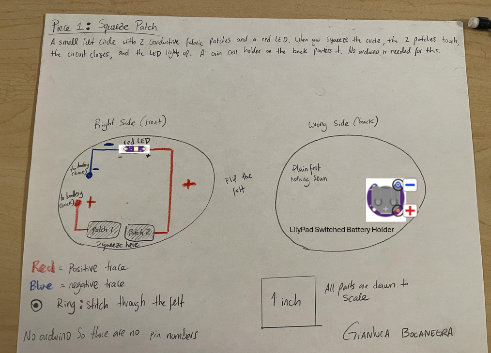
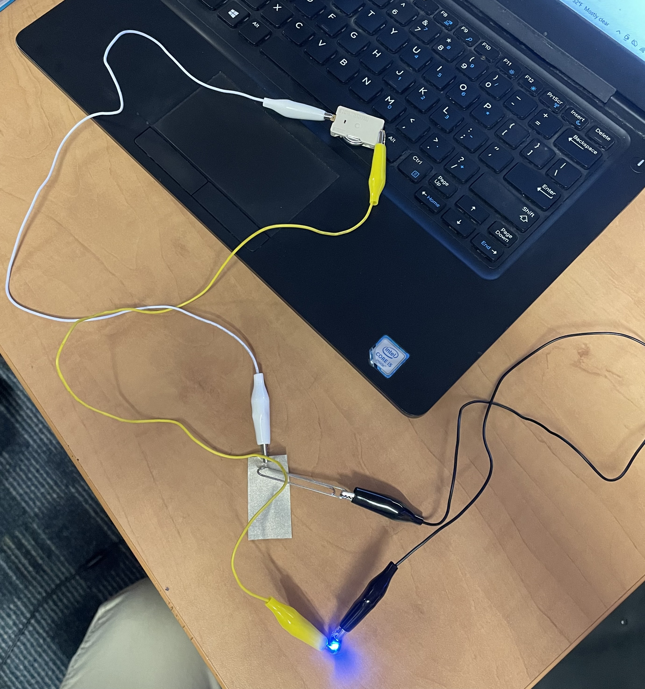
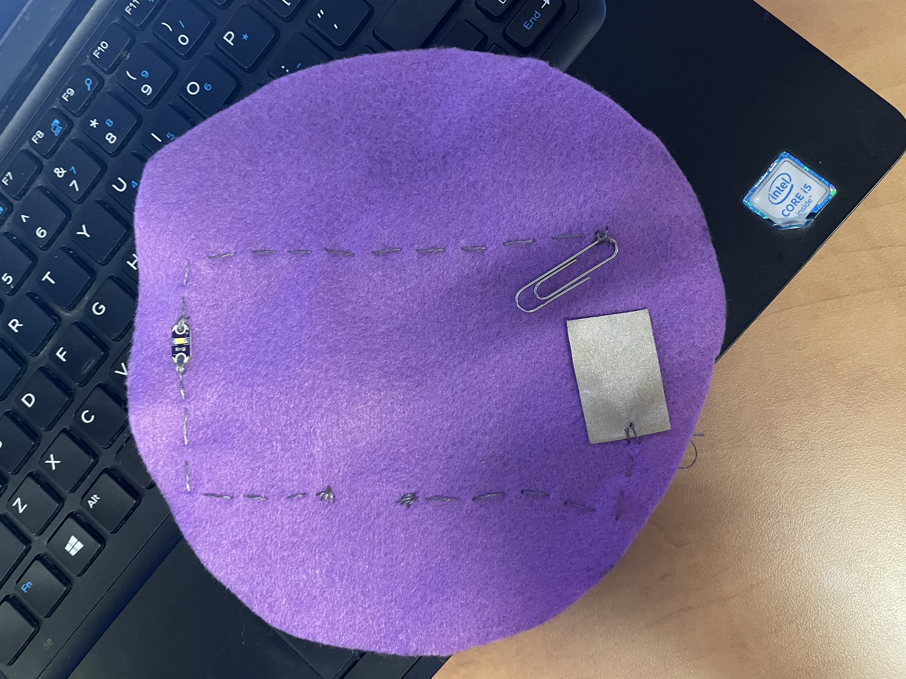
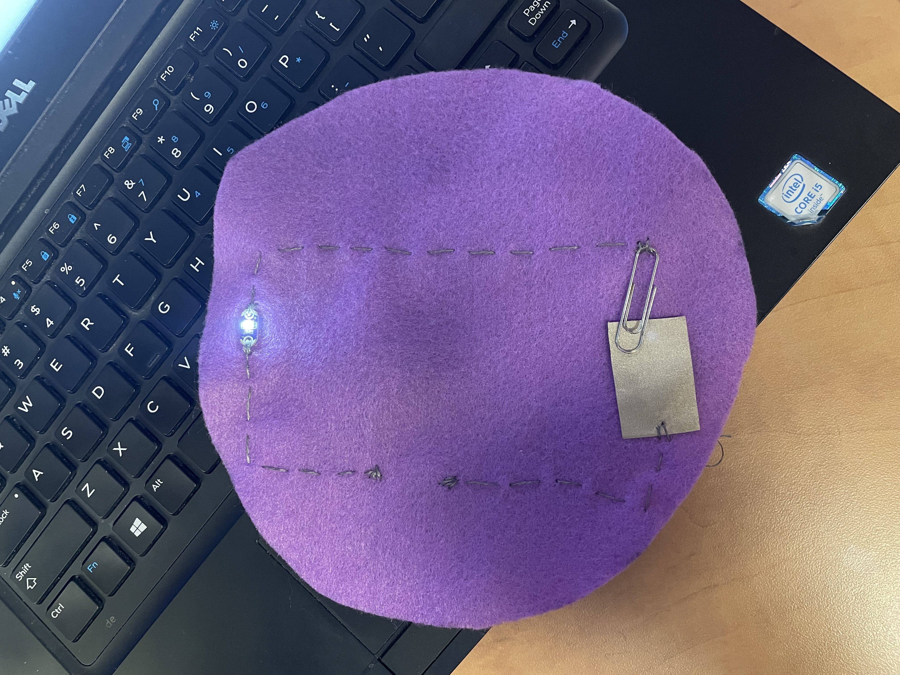

For this piece I made a felt patch with an LED on it. When you squeeze the patch the light turns on. When you let go it turns off. There is no button. Your hand is the switch.

**Why I made it:** I wanted a light that you turn on with your hand without having to find a button. You could put it on a backpack strap or a jacket and just squeeze it when you want to be seen. Think about walking home in the dark, you need your light on, but you're carrying things, wearing gloves or just not looking at your bag. Finding a tiny button in that moment is annoying and hard. A soft patch is different. You can find it by feel and press it with your whole hand even with your eyes on the road. That's why I made the switch part of the fabric instead of adding a hard button. 

**How it works:** There are two small pieces of conductive fabric, one on each side of a folded piece of felt. When I squeeze they touch and the circuit closes so the LED lights up. It uses a coin cell battery, no code.

## Materials

- Felt
- 2 pieces of conductive fabric
- Conductive thread
- Regular thread and a needle
- 1 red LED
- LilyPad switched battery holder
- CR2032 coin cell battery
- Alligator clips (for testing)
- Printed paper prototype

## Paper prototype

Paper prototype below. Red lines are + and blue lines are −

## Alligator clip test

Before sewing I tested it with alligator clips. Battery + goes to patch 1. Patch 2 goes to the LED +. The LED − goes back to battery -When I squeezed the patches together the LED turned on.

## The finished piece

Not squeezed so LED is off:

Squeezed so LED is on:

## 2 tips for my past self

1. Test with alligator clips before you sew anything. Sewing takes a long time and it's better to know if the circuit works first
2. Keep the + and − stitches far apart. If they touch the circuit shorts and the light won't work right

## Sources

- COMP 103 class handouts and the LilyPad component guide
